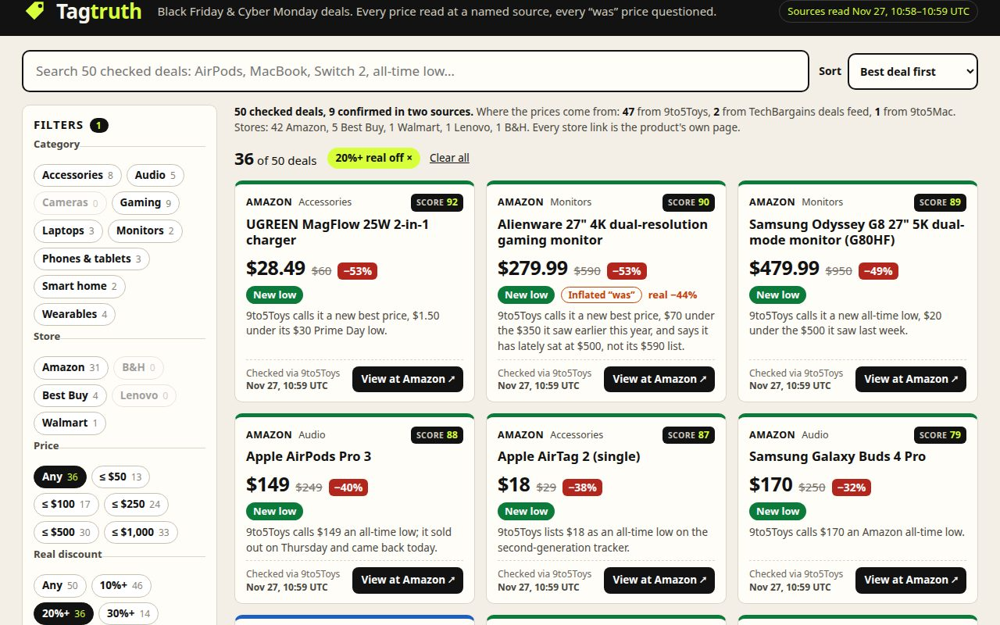

# mkfn-black_friday_deals

[](https://make.fun/bounty/black-friday-deal-finder-01)
[](https://make.fun/bounty/black-friday-deal-finder-01)
[](https://make.fun/bounty/black-friday-deal-finder-01)

An entry for the make.fun bounty [Build the best real Black Friday deal finder](https://make.fun/bounty/black-friday-deal-finder-01).

**Tagtruth** is a Black Friday and Cyber Monday deal finder for shoppers: 71 deals across 11 categories and 5 stores, each with its product, store, a link to it at that store, sale price, usual price, discount, where the price was read and when we checked it, plus an honest verdict on whether it is really a deal.



## How the deals were checked

On 2026-11-27 (Black Friday), between 10:58 and 11:04 UTC, we read deal posts that name the store and the price there, mostly [9to5Toys](https://9to5toys.com), and cross-checked them against [TechBargains](https://www.techbargains.com) where both listed the same item. Store pages themselves (Amazon, Walmart) answer automated reads with a bot check, so the deals sources are the price record. Every deal keeps:

- the **source post** and the time it went up, and the **time we read it**; reports older than 48 hours are flagged;
- the **store link**: the product's own page where the source linked to it (affiliate tags stripped), otherwise a store search for the exact product name, labelled as such;
- a **verdict** from the price history the source reports: *New low*, *Near best*, *Fair cut*, *Routine sale*, or *Inflated "was"*. Where the source says an item has really been selling for less than its "was" price, the card shows the **real** discount against that going rate.

Where two sources disagreed on a price (the M5 MacBook Air), the page says so and shows the higher one.

## Using it

- Search by product, brand, store or category; filter by category, store, minimum discount and verdict (every chip shows how many deals it leaves); sort by a verdict-weighted score, % off, real % off, dollars saved or price.
- Every view is in the address (`#/?cat=Audio&off=30`), so it can be bookmarked or shared. `#/deal/<id>` is a deal's page: price scale, evidence, source trail, the same product at other stores, and related deals.

## Layout

```
app/index.html        page shell
app/main.js           routing and wiring of the finder
app/data/deals.js     the deals; app/data/sources.js where and when each price was read
app/lib/              format.js (money, times), rating.js (discounts, verdicts, score), query.js (search, filters, sort)
app/ui/               list.js, controls.js, card.js, detail.js (loaded on demand)
main.ts               hands the site in with the kit's dossier builder
tools/shoot.mjs       takes the screenshots in shots.json with Playwright
```

Run it with `node serve.ts` and open http://localhost:8080. No build step and no network requests: the site is static files under `app/`.

## License

MIT
